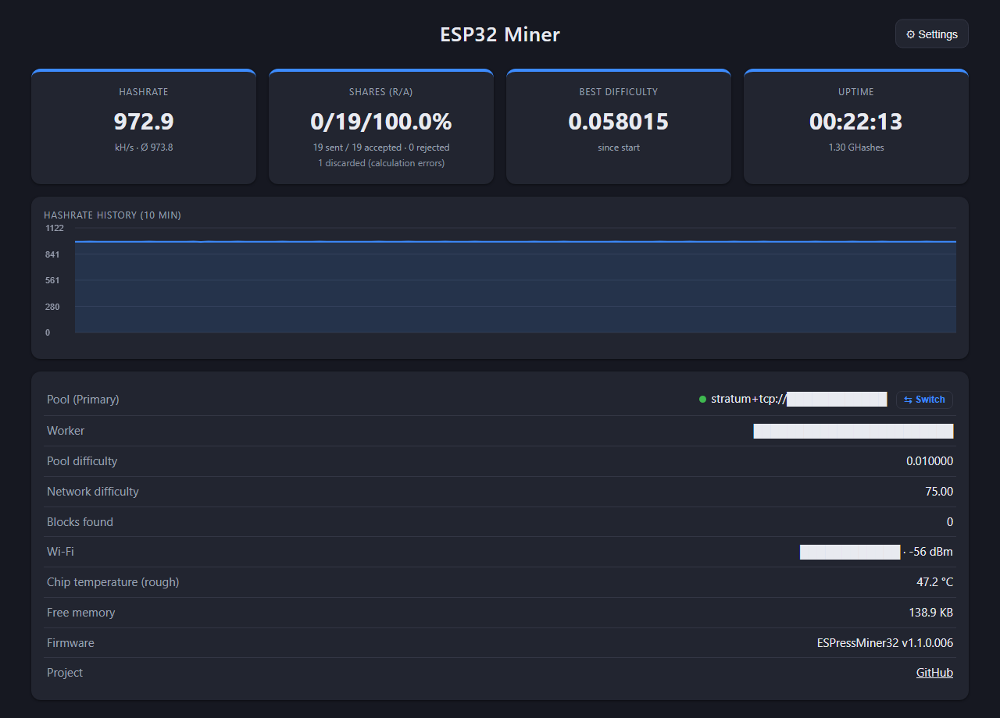

# ☕ ESPressMiner32 – DevKitC 38-Pin (Micro-USB)

🇬🇧 [English](README.md) · 🇩🇪 **Deutsch**

Ein Bitcoin-Stratum-Miner (V1) für den **klassischen ESP32**. Er nutzt den **SHA-256-Hardwarebeschleuniger**
per direktem Registerzugriff mit einer Pipeline: Die Daten für den nächsten Block werden geschrieben,
während die Engine noch rechnet.

Variante für das ältere **ESP32-DevKitC mit 38 Pins** (Nachbau, ESP-WROOM-32, ESP32-D0WDQ6 **Revision 1.0**,
CP2102, Micro-USB; erkennbar an **3V3 und GND ganz oben** links/rechts neben der Antenne)

<p align="center"><br>
<sub>Das ältere Board: <b>Micro-USB</b>, 3V3/GND ganz oben, G13 neben GND. Läuft die Firmware auf einem
anderen ESP32 mit Rev.-1-Chip, greift der Fix genauso – die Revision wird automatisch erkannt.</sub></p>
mit optionaler externer **LED an GPIO13**.

> 💡 **LED ist optional** – der Miner läuft auch ohne. Wer eine möchte:
> GPIO13 → Vorwiderstand 220–330 Ω → LED-Anode (langes Bein), Kathode → GND.
> GPIO13 wurde gewählt, weil **G13 auf diesem Board direkt neben einem GND-Pin** (zwischen G12 und G13) liegt – eine LED
> mit Vorwiderstand lässt sich so einfach auf die beiden Nachbar-Pins stecken.
> Anderer Pin: `LED_PIN` in `include/config.h` ändern (`-1` = keine LED).
> Verhalten: blinkt langsam im Einrichtungs-Portal, leuchtet beim Minen, kurz aus bei jedem Share.

Gemessen auf ESP32-D0WDQ6 Rev. 1.0 @ 240 MHz, **v1.1.0.006: ~973 kH/s** (Hardware 942 + Software-Miner 31,
252 Takte pro Double-SHA256). Vorher (v1.0.0): 786 kH/s → **+24 %**.
Auf ESP32-D0WD-V3 (Revision 3) nimmt dieselbe Firmware automatisch die Schleife ohne Schutz (~1019 kH/s im Hauptprojekt).

<p align="center"><br>
<sub>Dashboard des Testboards (ESP32 Rev. 1.0) mit v1.1.0.006 – Pool, Worker und WLAN geschwärzt.
Nachtlauf mit v1.1.0.004 (11,1 h, Ø 973,2 kH/s): <a href="docs/nachtlauf_v1.1.0.004.png">Diagramm</a>.
Konsolen-Ausgabe beim Start (Chip-Revision, Selbsttest, Benchmark): <a href="docs/konsole_v1.1.0.001.log">docs/konsole_v1.1.0.001.log</a></sub></p>

> **Der Rev.-1-Fehler:** ESP32 bis Revision 1.x haben einen Hardwarefehler (Espressif-Errata 3.10):
> Liest ein Kern ein DPORT-Register (dort liegt der SHA-Beschleuniger), während der andere Kern
> APB-Register liest, bekommt der andere Kern falsche Daten. Folge: `wifi assert` und
> Watchdog-Neustart direkt nach Mining-Beginn. Die Firmware erkennt die Chip-Revision beim Start und
> liest den SHA-Puffer dann mit der geschützten Sequenz aus ESP-IDF (Interrupts sperren → Dummy-Lesen auf APB →
> SHA-Register lesen).
>
> **Neu in v1.1.0.001:** Die schnelle Hash-Schleife v2 (aus NerdMiner Modded) liest pro Nonce nur **ein** Wort (H7)
> aus dem SHA-Puffer. Das Hauptprojekt schaltet sie auf alten Chips trotzdem ab. Hier gibt es eigene Varianten, die
> genau dieses eine Lesen schützen. Kosten: ~19 Takte pro Hash (259 statt 240) statt ~13 % wie in v1.0.0.

### Nachtlauf (v1.1.0.004)

Testboard (ESP32-D0WDQ6 Rev. 1.0) am eigenen Stratum-Pool, Software-Miner an, Protokoll alle 2 Minuten über
`/api/stats` (`tools/miner_logger.py`). 13./14.10.2026, 21:46–08:55 Uhr:

| | Wert |
|---|---|
| Dauer | **11,1 h**, 335 Messpunkte, **0 Neustarts** |
| Hashrate | **Ø 973,2 kH/s**, Spanne nur 971,8–974,5 |
| Shares beim Pool angekommen | 890 in 11 h → **~965 kH/s echte Arbeit** (±3 % statistische Schwankung) |
| Rechenfehler (verworfen) | **6 von 587.751** Kandidaten (~0,001 %), keiner ging an den Pool |
| Chip-Temperatur (grob) | 43–46 °C, Überhitzungsschutz nie ausgelöst |

Zum Vergleich in derselben Nacht am selben Pool: fünf NerdMiner zwischen 959 und 999 kH/s.

<p align="center"><br>
<sub>Verlauf der Nacht (bis 09:07): Hashrate laut Miner, Shares je Stunde am Pool (× 11,93 = kH/s), Chip-Temperatur und
verworfene Rechenfehler. Rohdaten aller Messpunkte: <a href="docs/nachtlauf_v1.1.0.004.csv">docs/nachtlauf_v1.1.0.004.csv</a></sub></p>

### Langzeittest (v1.0.0)

Ein Board dieser Variante läuft im Dauerbetrieb (Außengehäuse, WLAN über Repeater) am öffentlichen Pool
hmpool.io. Stand nach **13 h 26 min** ohne Neustart (Oktober 2026):

| | Wert |
|---|---|
| Hashrate | **786 kH/s**, konstant (Schnitt 786,1) |
| Hashes gesamt | 38,0 Mrd. |
| Shares erwartet (bei Pool-Difficulty 0,01) | 885 |
| Shares gesendet / angenommen / abgelehnt | 874 / 873 / 0 |
| Abweichung | **−1,3 %** (bei 885 Shares liegt die statistische Schwankung bei ±3,4 %) |
| Rechenfehler (vom Dashboard gezählt) | 19 |

**Die angezeigte Hashrate stimmt also mit der Arbeit überein, die tatsächlich beim Pool ankommt.**

**Zu den 19 Rechenfehlern:** Um diese Geschwindigkeit zu erreichen, wird der SHA-Baustein nicht nach
Datenblatt betrieben (Schreiben, während er rechnet, feste Wartezeiten statt BUSY-Abfrage). Dabei rechnet er
gelegentlich falsch. Das Dashboard zählt nur die falschen Hashes, die zufällig wie ein Treffer aussehen
(etwa einer von 65.536). Hochgerechnet sind 19 davon in 13 Stunden **etwa 1 falscher Hash je 30.000, also
~0,003 %**. Jeder Treffer wird vor dem Senden in Software nachgerechnet, **ein falscher Hash geht nie an den
Pool**. Auf den Ertrag hat das keinen messbaren Einfluss.

🔗 **Projektseite:** https://github.com/brenner23/ESPressMiner32-DevKitC-MicroUSB  
🔗 **Hauptprojekt (USB-C, Rev. 3):** https://github.com/brenner23/ESPressMiner32

> ⚠️ **Hobbyprojekt.** Mit einem ESP32 findet man realistisch keinen Bitcoin-Block. Es geht ums Lernen,
> Basteln und Ausreizen der Hardware. Ideal für Solo-Pools, Lotterie-Mining oder den eigenen Test-Pool.

---

## Funktionen

- **~973 kH/s** auf ESP32 Rev. 1.0 (v1.1.0.006), Rev. 3 ohne Schutz schneller – Revision wird automatisch erkannt
- **Hash-Schleife v2** in Assembler (portiert aus NerdMiner Modded), Auswahl per Known-Answer-Test mit Rückfallstufen
- **Software-Miner auf Core 0** zusätzlich (~31 kH/s)
- **Chip-Temperatur** im Dashboard, **Überhitzungsschutz** (90 °C SW-Miner Pause, 100 °C Stopp, weiter unter 80 °C)
- **Selbsttest** beim Start (Genesis-Block, 2000 Zufalls-Header, 5000 Nonces). Schlägt er fehl, wird nicht gemint.
- **Jeder Treffer wird in Software nachgerechnet**, bevor ein Share zum Pool geht
- **WLAN-Wächter** (v1.1.0.006): nach 10 s ohne WLAN neu verbinden (Suche über alle Kanäle, z. B. nach einem
  Kanalwechsel im Mesh), nach 3 min offline Neustart
- **Schutzfenster** (v1.1.0.006): stört ein Gerät im Netz den ESP32 in festem Takt (auf dem USB-C-Board Fehler-Schübe
  alle ~600 s), lernt der Miner den Takt und rechnet ein paar Sekunden um den Zeitpunkt herum mit einer vorsichtigeren Schleife
- **Web-Dashboard** unter `http://espressminer.local/` mit Hashrate-Verlauf, JSON unter `/api/stats` – Oberfläche und Konsole auf Englisch (ab v1.1.0.005)
- **Primary- und Secondary-Pool** mit automatischem Wechsel
- **Einrichtung ohne Programmieren:** WLAN-Portal, Setup-Programm mit Oberfläche oder Kommandozeile
- **Optionale LED an GPIO13** leuchtet beim Minen und blinkt bei jedem Share

## Projektstruktur

```
ESPressMiner32/
├── platformio.ini            Build-Konfiguration (240 MHz, -O2)
├── include/
│   ├── credentials.h         Startwerte (leer, optional)
│   ├── config.h              Difficulty, Cores, LED, Nonce-Bereiche
│   ├── sha256_hw.h           Hardware-SHA-Pipeline, Auswahl der Hash-Schleife
│   ├── sha256_sw.h           Software-SHA-256 (Coinbase, Merkle, Prüfung)
│   ├── stratum_client.h      Stratum-V1-Client
│   ├── mining_job.h          Job-/Share-Austausch zwischen den Tasks
│   └── ...
├── src/                      Implementierungen zu den Headern + main.cpp
│   ├── hw_scan_v2.S          Hash-Schleife v2 (NerdMiner Modded, MIT) + Varianten J und *_df (Rev. 1)
│   └── sha256_hw.cpp         Treiber, Errata-3.10-Schutz, Known-Answer-Test, Laufzeit-Kontrolle
├── CHANGELOG.md              Versionen
├── MESSPROTOKOLL.md          Messwerte je Schritt
├── tools/                    Setup per USB: espressminer_setup_gui.py (Oberfläche), espressminer_setup.py
└── test/hw_probe/            Messprogramm für den SHA-Beschleuniger (Entwicklung)
```

## Bauen & Flashen (VS Code + PlatformIO)

1. Ordner in VS Code öffnen (die PlatformIO-Erweiterung wird vorgeschlagen).
2. ESP32 per USB anschließen. PlatformIO findet den COM-Port automatisch.
3. Unten in der Statusleiste **→ Upload** (bzw. `pio run -t upload`).
4. **Serial Monitor** (115200 Baud) zeigt Selbsttest, Benchmark und alle 5 s die Hashrate.

Zugangsdaten müssen nicht in den Code: `include/credentials.h` ist absichtlich leer, eingerichtet wird nach dem Flashen.

## Ersteinrichtung (nach dem Flashen)

Solange keine Einstellungen gespeichert sind, startet der Miner **nicht** zum Minen, sondern wartet auf die Einrichtung.

**1. WLAN-Portal (Handy/Laptop)**
Mit dem WLAN `ESPressMiner32-XXXX` (Passwort `espressminer`) verbinden. Die Einrichtungsseite öffnet sich
automatisch, sonst `http://192.168.4.1/` aufrufen. Ausfüllen, „Save & restart“.
Das Portal startet auch, wenn das gespeicherte WLAN 20 s lang nicht erreichbar ist.

**2. Setup-Programm mit Oberfläche** (`pip install pyserial`)
```
python tools/espressminer_setup_gui.py
```
COM-Port wählen, Felder ausfüllen (oder „JSON laden …“), „Speichern & Neustart“.
Vorlage für mehrere Miner: `tools/credentials.example.json`.

**3. Kommandozeile über USB**
```
python tools/espressminer_setup.py                 # interaktiv, COM-Port wird gesucht
python tools/espressminer_setup.py --port COM3 --get
python tools/espressminer_setup.py --ssid MeinWLAN --password geheim ^
       --pool stratum+tcp://pool.example.com:3333 --wallet ADRESSE.Worker -y
python tools/espressminer_setup.py --reset         # Einstellungen löschen -> Portal
```

**4. Serielle Konsole direkt** (115200 Baud), eine JSON-Zeile pro Befehl, Antworten beginnen mit `@CM `:
```
{"cmd":"info"}   {"cmd":"get"}   {"cmd":"reset"}   {"cmd":"restart"}
{"cmd":"set","hostname":"espressminer","wifiSsid":"...","wifiPass":"...",
 "pools":[{"url":"stratum+tcp://host:3333","user":"ADRESSE.Worker","pass":"x"},{"url":""}]}
```

**Zurücksetzen ohne PC:** BOOT-Taste 5 s gedrückt halten → Einstellungen gelöscht, Neustart ins Portal.

## Ablauf

| Core | Aufgabe |
|------|---------|
| 1 | Hardware-SHA-Miner (exklusiv) |
| 0 | WLAN, Stratum-Client, Web-Dashboard, Statistik |

- **Einstellungen** (Zahnrad „Settings“ im Dashboard): Hostname, WLAN, Primary- und Secondary-Pool, gespeichert im Flash (NVS).
  Nach 3 Fehlversuchen wechselt der Miner zum anderen Pool, vom Secondary aus wird alle 10 Minuten der Primary erneut versucht.
- Das Dashboard läuft auf Core 0 und kostet keine Hashrate.

## Wie die Hashrate zustande kommt

| Schritt | kH/s |
|---|---|
| Einfacher Hardware-Weg (BUSY abfragen) | ~360 |
| Pipeline: nächsten Block schreiben, während die Engine rechnet | ~557 |
| Textregister gepuffert schreiben, ohne `memw` (Idee aus SparkMiner) | ~650 |
| Basisadresse im Register statt `l32r` pro Zugriff | ~700 |
| Feste Wartezeiten statt BUSY (das Flag hängt ~34 Takte nach) | ~800 |
| Kein `memw` nach LOAD | ~833 |
| Wartezeit je Phase einzeln kalibriert | ~842 |
| Software-Pipeline: nächsten Block 1 vor der Kandidatenprüfung starten | ~902 |
| Hash-Schleife v2 aus NerdMiner Modded (gezählte Wartezeiten, Writes ≥ 3 Takte auseinander) | ~963 |
| + Software-Miner auf Core 0 (stört v2 nicht mehr) | ~990 |
| Variante J: Header-Wörter in Registern, Write-Abstand 2 Takte | ~1019 |

Die Werte oben gelten für Rev. 3 (Hauptprojekt). Auf **Rev. 1.0** (diese Variante):

| Stand | kH/s |
|---|---|
| v1.0.0: kalibrierte Pipeline, jedes Lesen geschützt | 786 |
| v1.1.0.001: Variante J, nur das H7-Lesen geschützt | ~950 |
| v1.1.0.002: Schutz in der LOAD-Wartezeit vorbereitet | ~962 |
| v1.1.0.003: Schutz mit den Header-Writes verschachtelt | ~972 |
| **v1.1.0.006: gleiche Schleife + WLAN-Wächter und Schutzfenster** | **~973** |

Die Wartezeiten werden bei jedem Start **kalibriert**: Der ESP32 sucht die kleinste fehlerfreie Wartezeit und
schlägt `HW_CAL_MARGIN_*` Takte Reserve drauf. Im laufenden Betrieb bleiben sie unverändert. Falsch berechnete
Treffer werden bei der Software-Prüfung verworfen und im Dashboard als „discarded (calculation errors)“ gezählt.

Der klassische ESP32 kann keinen SHA-Zwischenstand (Midstate) in die Engine zurückladen. Pro Nonce sind deshalb
immer drei Hardware-Blöcke nötig.

Messwerkzeug: `pio run -e hw_probe -t upload` (misst Registerzugriffe, Engine-Zeiten, Phasenprofil).

## Entwicklung

Entwickelt mit Unterstützung von [Claude](https://claude.ai) (Anthropic) als KI-Programmierassistent. Entscheidungen, Tests auf echter Hardware und Messungen: brenner23.

## Lizenz

[MIT](LICENSE) © 2026 brenner23. Nutzung auf eigene Verantwortung.
Danksagungen und Bibliotheken: [THIRD_PARTY_LICENSES.md](THIRD_PARTY_LICENSES.md).

**Verwendet / Quellen:**
- **NerdMiner Modded** (MIT, HenrysCat) – https://github.com/HenrysCat/NerdMiner-Modded –
  `src/hw_scan_v2.S` ist ein Port von deren `pipelined_hw_sha_classic_v2.S`, dazu die Idee von Known-Answer-Test
  und Rückfallstufen. Lizenztext in THIRD_PARTY_LICENSES.md. Upstream: NerdMiner_v2 (MIT, BitMaker-hub).
- **SparkMiner** (MIT, BitzyLabs) – https://github.com/BitzyLabs/sparkminer – nur die Idee gepufferter Register-Writes.
- **Espressif** – ESP32 Errata 3.10 und ESP-IDF `esp_dport_access_reg_read` (Apache-2.0) – Lesesequenz nachgebaut, kein Code kopiert.
- Eigene Arbeit: Pipeline, Kalibrierung, Variante J, geschützte `*_df`-Schleifen, Dashboard, Setup-Werkzeuge.
