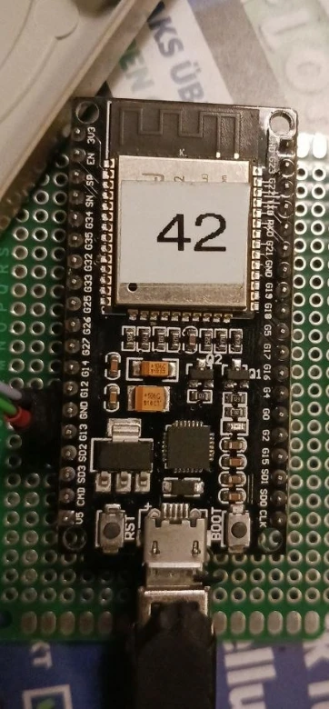
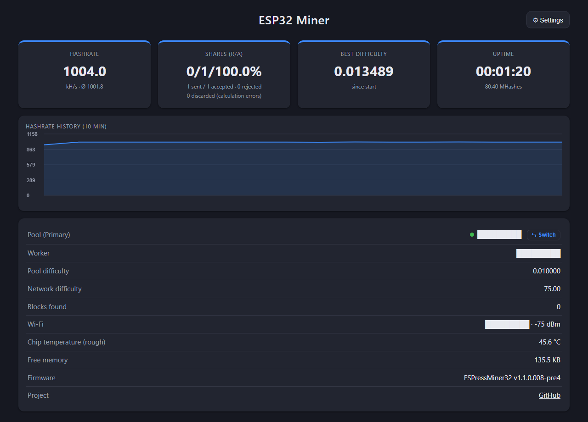

# ☕ ESPressMiner32 – DevKitC 38-pin (Micro-USB)

🇬🇧 **English** · 🇩🇪 [Deutsch](README.de.md)

A Bitcoin Stratum (V1) miner for the **classic ESP32**. It drives the **SHA-256 hardware accelerator**
through direct register access with a pipeline: the data for the next block is written while the engine
is still computing.

Variant for the older **38-pin ESP32-DevKitC** (clone, ESP-WROOM-32, ESP32-D0WDQ6 **revision 1.0**,
CP2102, Micro-USB; recognisable by **3V3 and GND at the very top** left/right next to the antenna)

<p align="center"><br>
<sub>The older board: <b>Micro-USB</b>, 3V3/GND at the very top, G13 next to GND. On any other ESP32 with a
rev. 1 chip the fix applies just the same – the revision is detected automatically.</sub></p>
with an optional external **LED on GPIO13**.

> 💡 **The LED is optional** – the miner works fine without it. If you want one:
> GPIO13 → 220–330 Ω resistor → LED anode (long leg), cathode → GND.
> GPIO13 was chosen because **G13 sits right next to a GND pin on this board** (between G12 and G13) – an LED with a
> resistor simply plugs onto those two neighbouring pins.
> Different pin: change `LED_PIN` in `include/config.h` (`-1` = no LED).
> Behaviour: slow blink in the setup portal, on while mining, briefly off on every share.

Measured on ESP32-D0WDQ6 rev. 1.0 @ 240 MHz, **v1.1.0.007: ~1000 kH/s** (hardware 969 + software miner 31,
247 cycles per double SHA-256). Before (v1.0.0): 786 kH/s → **+27 %**.
**Pre-release v1.1.0.008-pre4 (testing): ~1006 kH/s** (hardware 971.8 + software 33.1), long-term test running.

> **1000 kH/s on an ESP32 rev. 1.0** – despite the errata 3.10 protection that every hash on this old chip needs.
On ESP32-D0WD-V3 (revision 3) the same firmware automatically uses the loop without protection (~1019 kH/s in the main project).

<p align="center"><br>
<sub>Dashboard of the test board (ESP32 rev. 1.0) running v1.1.0.007 at ~1000 kH/s – pool, worker and Wi-Fi redacted.
Overnight run of v1.1.0.004 (11.1 h, Ø 973.2 kH/s): <a href="docs/nachtlauf_v1.1.0.004.png">chart</a>.
Console output at boot (chip revision, self-test, benchmark): <a href="docs/konsole_v1.1.0.001.log">docs/konsole_v1.1.0.001.log</a></sub></p>

> **The rev. 1 bug:** ESP32 up to revision 1.x has a silicon bug (Espressif errata 3.10): when one core
> reads a DPORT register (where the SHA accelerator lives) while the other core reads APB registers,
> the other core can get corrupted data. Result: `wifi assert` and a watchdog reset right after mining
> starts. The firmware detects the chip revision at boot and then reads the SHA buffer using the
> protected sequence from ESP-IDF (raise interrupt level → dummy APB read → read the SHA register).
>
> **New in v1.1.0.001:** the fast v2 hash loop (from NerdMiner Modded) reads only **one** word (H7) from the SHA
> buffer per nonce. The main project still disables it on old chips; here dedicated variants protect exactly that
> one read. Cost: ~19 cycles per hash (259 instead of 240) instead of ~13 % as in v1.0.0.

### Overnight run (v1.1.0.004)

Test board (ESP32-D0WDQ6 rev. 1.0) on our own stratum pool, software miner on, logged every 2 minutes via
`/api/stats` (`tools/miner_logger.py`). 13/14 Oct 2026, 21:46–08:55:

| | Value |
|---|---|
| Duration | **11.1 h**, 335 samples, **0 restarts** |
| Hashrate | **avg 973.2 kH/s**, range only 971.8–974.5 |
| Shares received by the pool | 890 in 11 h → **~965 kH/s of real work** (±3 % statistical spread) |
| Calculation errors (discarded) | **6 of 587,751** candidates (~0.001 %), none reached the pool |
| Chip temperature (coarse) | 43–46 °C, overheat protection never triggered |

For comparison, same night, same pool: five NerdMiners between 959 and 999 kH/s.

<p align="center"><br>
<sub>The night (until 09:07): hashrate reported by the miner, shares per hour at the pool (× 11.93 = kH/s), chip temperature and
discarded calculation errors. Raw data of all samples: <a href="docs/nachtlauf_v1.1.0.004.csv">docs/nachtlauf_v1.1.0.004.csv</a></sub></p>

### Long-term test (v1.0.0)

One board of this variant runs continuously (outdoor enclosure, Wi-Fi via repeater) on the public pool
hmpool.io. Status after **13 h 26 min** without a restart (October 2026):

| | Value |
|---|---|
| Hashrate | **786 kH/s**, constant (average 786.1) |
| Total hashes | 38.0 billion |
| Expected shares (pool difficulty 0.01) | 885 |
| Shares sent / accepted / rejected | 874 / 873 / 0 |
| Deviation | **−1.3 %** (with 885 shares the statistical spread is ±3.4 %) |
| Calculation errors (counted by the dashboard) | 19 |

**So the displayed hashrate matches the work that actually arrives at the pool.**

**About the 19 calculation errors:** to reach this speed the SHA block is not driven by the datasheet
(writing while it computes, fixed wait times instead of polling BUSY), so it occasionally miscalculates.
The dashboard only counts wrong hashes that happen to look like a hit (about one in 65,536). Scaled up,
19 in 13 hours means **about 1 wrong hash per 30,000, i.e. ~0.003 %**. Every hit is recomputed in software
before it is sent, so **a wrong hash never reaches the pool**. There is no measurable effect on earnings.

🔗 **Project page:** https://github.com/brenner23/ESPressMiner32-DevKitC-MicroUSB  
🔗 **Main project (USB-C, rev. 3):** https://github.com/brenner23/ESPressMiner32

> ⚠️ **Hobby project.** Realistically an ESP32 will never find a Bitcoin block. This is about learning,
> tinkering and pushing the hardware to its limit. Great for solo pools, lottery mining or your own test pool.
>
> The web UI, setup tools and serial output are in German.

---

## Features

- **~1000 kH/s** on ESP32 rev. 1.0 (v1.1.0.007), rev. 3 runs faster without protection – revision detected automatically
- **Hash loop v2** in assembly (ported from NerdMiner Modded), chosen by a known-answer test with fallback stages
- **Software miner on core 0** in addition (~31 kH/s, ~33 kH/s with the fast scan since v1.1.0.008-pre3)
- **Chip temperature** on the dashboard, **overheat protection** (90 °C pause SW miner, 100 °C stop, resume below 80 °C)
- **Self-test** at boot (genesis block, 2000 random headers, 5000 nonces). If it fails, the miner does not mine.
- **Every hit is re-checked in software** before a share is sent to the pool
- **Wi-Fi watchdog** (v1.1.0.006): reconnects after 10 s without Wi-Fi (scan over all channels, e.g. after a mesh
  channel change), restarts the miner after 3 min offline
- **Guard window** (v1.1.0.006): if a device on the network disturbs the ESP32 at a fixed interval (error bursts every
  ~600 s were seen on the USB-C board), the miner learns the interval and switches to a more careful loop for a few seconds around it
- **Web dashboard** at `http://espressminer.local/` with hashrate history, JSON at `/api/stats` – UI and serial console in English (since v1.1.0.005)
- **Primary and secondary pool** with automatic failover
- **Setup without coding:** Wi-Fi portal, GUI setup tool or command line
- **Optional LED on GPIO13** is on while mining and blinks on every share

## Project layout

```
ESPressMiner32/
├── platformio.ini            Build configuration (240 MHz, -O2)
├── include/
│   ├── credentials.h         Default values (empty, optional)
│   ├── config.h              Difficulty, cores, LED, nonce ranges
│   ├── sha256_hw.h           Hardware SHA pipeline, hash loop selection
│   ├── sha256_sw.h           Software SHA-256 (coinbase, merkle, verification)
│   ├── stratum_client.h      Stratum V1 client
│   ├── mining_job.h          Job/share exchange between tasks
│   └── ...
├── src/                      Implementations + main.cpp
│   ├── hw_scan_v2.S          Hash loop v2 (NerdMiner Modded, MIT) + variants J and *_df (rev. 1)
│   └── sha256_hw.cpp         Driver, errata 3.10 protection, known-answer test, runtime check
├── CHANGELOG.md              Versions (German)
├── MESSPROTOKOLL.md          Measurements per step (German)
├── tools/                    USB setup: espressminer_setup_gui.py (GUI), espressminer_setup.py
└── test/hw_probe/            Measurement firmware for the SHA accelerator (development)
```

## Build & flash (VS Code + PlatformIO)

1. Open the folder in VS Code (the PlatformIO extension will be suggested).
2. Connect the ESP32 via USB. PlatformIO finds the COM port automatically.
3. Click **→ Upload** in the status bar (or `pio run -t upload`).
4. The **serial monitor** (115200 baud) shows the self-test, the benchmark and the hashrate every 5 s.

No credentials in the code: `include/credentials.h` is intentionally empty, everything is configured after flashing.

## First-time setup (after flashing)

As long as no settings are stored, the miner does **not** start mining but waits to be configured.

**1. Wi-Fi portal (phone/laptop)**
Connect to the Wi-Fi `ESPressMiner32-XXXX` (password `espressminer`). The setup page opens automatically,
otherwise go to `http://192.168.4.1/`. Fill in the form, then "Save & restart".
The portal also starts if the stored Wi-Fi cannot be reached for 20 s.

**2. GUI setup tool** (`pip install pyserial`)
```
python tools/espressminer_setup_gui.py
```
Pick the COM port, fill in the fields (or load a JSON file), save & restart.
Template for multiple miners: `tools/credentials.example.json`.

**3. Command line over USB**
```
python tools/espressminer_setup.py                 # interactive, COM port is detected
python tools/espressminer_setup.py --port COM3 --get
python tools/espressminer_setup.py --ssid MyWiFi --password secret ^
       --pool stratum+tcp://pool.example.com:3333 --wallet ADDRESS.worker -y
python tools/espressminer_setup.py --reset         # erase settings -> portal
```

**4. Raw serial console** (115200 baud), one JSON line per command, replies start with `@CM `:
```
{"cmd":"info"}   {"cmd":"get"}   {"cmd":"reset"}   {"cmd":"restart"}
{"cmd":"set","hostname":"espressminer","wifiSsid":"...","wifiPass":"...",
 "pools":[{"url":"stratum+tcp://host:3333","user":"ADDRESS.worker","pass":"x"},{"url":""}]}
```

**Reset without a PC:** hold the BOOT button for 5 s → settings erased, restart into the portal.

## How it works

| Core | Task |
|------|------|
| 1 | Hardware SHA miner (exclusive) |
| 0 | Wi-Fi, Stratum client, web dashboard, statistics |

- **Settings** (gear icon in the dashboard): hostname, Wi-Fi, primary and secondary pool, stored in flash (NVS).
  After 3 failed attempts the miner switches to the other pool; from the secondary it retries the primary every 10 minutes.
- The dashboard runs on core 0 and costs no hashrate.

## Where the hashrate comes from

| Step | kH/s |
|---|---|
| Plain hardware path (polling BUSY) | ~360 |
| Pipeline: write the next block while the engine computes | ~557 |
| Buffered text register writes without `memw` (idea from SparkMiner) | ~650 |
| Base address kept in a register instead of `l32r` per access | ~700 |
| Fixed wait times instead of BUSY (the flag lags ~34 cycles) | ~800 |
| No `memw` after LOAD | ~833 |
| Wait time calibrated per phase | ~842 |
| Software pipeline: start the next block 1 before the candidate check | ~902 |
| Hash loop v2 from NerdMiner Modded (counted delays, stores ≥ 3 cycles apart) | ~963 |
| + software miner on core 0 (no longer disturbs v2) | ~990 |
| Variant J: header words in registers, store spacing 2 cycles | ~1019 |

The values above are for rev. 3 (main project). On **rev. 1.0** (this variant):

| Version | kH/s |
|---|---|
| v1.0.0: calibrated pipeline, every read protected | 786 |
| v1.1.0.001: variant J, only the H7 read protected | ~950 |
| v1.1.0.002: protection prepared during the LOAD wait | ~962 |
| v1.1.0.003: protection interleaved with the header writes | ~972 |
| v1.1.0.006: same loop + Wi-Fi watchdog and guard window | ~973 |
| **v1.1.0.007: protected H7 read moved into the LOAD wait** | **~1000** |
| v1.1.0.008-pre4 (pre-release): interrupts masked per batch, fast software scan (in flash), Wi-Fi wave errors shown separately | ~1006 |

### Wi-Fi waves and guard window

In long-term tests the remaining calculation errors came almost only as **bursts of 5–8 errors, every ~600 s like
clockwork** – on the USB-C board and on this rev. 1 board alike. The cause is not the miner but the **Wi-Fi connection**:
the timing is tied to the ESP's Wi-Fi association and shifts when it reconnects. Most likely it is a periodic action of
the access point, e.g. key renewal or the mesh function of a **FRITZ!Box** router. Depending on your router the period
may differ or the waves may not exist at all.

The **guard window** (since v1.1.0.006) learns this period from the bursts (1–30 min) and mines with a more careful loop
from 6 s before to 6 s after the expected moment. Every 6th window stays unprotected as a probe, so the miner notices
whether the wave is still there – that probe is where the ~8 errors per hour come from. After a restart the first wave
hits unprotected because the period is not known yet.

**Display (since v1.1.0.008-pre4, a measuring aid – work in progress):** the dashboard shows the errors separately, e.g.
`0 discarded (calculation errors) (+8 from 1 Wi-Fi wave)`. The first number are errors of the hash loop itself, in brackets
the errors from Wi-Fi waves and the number of waves. **Nothing is deleted:** `/api/stats` still returns `hwErrors` (total)
plus `waveErrors` and `loopErrors`. If in doubt, `hwErrors` counts. Every hit is re-checked in software either way –
a miscalculated hit never becomes a share.

<p align="center"><br>
<sub>v1.1.0.008-pre4 on the rev. 1.0 test board, 80 s after power-on – pool, worker and Wi-Fi redacted.</sub></p>

The wait times are **calibrated at every boot**: the ESP32 searches for the smallest error-free wait time and
adds `HW_CAL_MARGIN_*` cycles of headroom. They stay unchanged during operation. Miscalculated hits are
discarded by the software check and counted in the dashboard as "discarded (calculation errors)" (discarded,
calculation error).

The classic ESP32 cannot load a SHA midstate back into the engine, so every nonce always needs three hardware blocks.

Measurement tool: `pio run -e hw_probe -t upload` (register access costs, engine timings, phase profile).

## Development

Developed with the assistance of [Claude](https://claude.ai) (Anthropic) as an AI coding assistant. Design decisions, testing on real hardware and measurements by brenner23.

## License

[MIT](LICENSE) © 2026 brenner23. Use at your own risk.
Credits and libraries: [THIRD_PARTY_LICENSES.md](THIRD_PARTY_LICENSES.md).

**Used / sources:**
- **NerdMiner Modded** (MIT, HenrysCat) – https://github.com/HenrysCat/NerdMiner-Modded –
  `src/hw_scan_v2.S` is a port of their `pipelined_hw_sha_classic_v2.S`, plus the idea of the known-answer test
  and fallback stages. License text in THIRD_PARTY_LICENSES.md. Upstream: NerdMiner_v2 (MIT, BitMaker-hub).
- **SparkMiner** (MIT, BitzyLabs) – https://github.com/BitzyLabs/sparkminer – only the idea of buffered register writes.
- **Espressif** – ESP32 errata 3.10 and ESP-IDF `esp_dport_access_reg_read` (Apache-2.0) – read sequence re-implemented, no code copied.
- Own work: pipeline, calibration, variant J, protected `*_df` loops, dashboard, setup tools.
